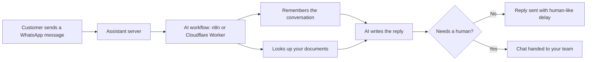

# WhatsApp AI Assistant

**An AI assistant that answers your customers on WhatsApp around the clock, in their own language, and hands the conversation to a human when it should.**

Project by **Hamza Tariq**, AI Automation Expert.

---

## The problem

For most businesses, WhatsApp is where customers actually write. That creates a daily grind:

- **Customers wait.** Questions arrive at night, on weekends and during busy hours, and the answer comes hours later (or never).
- **The same questions repeat.** Prices, opening hours, availability and "how do I book?" take up most of the team's chat time.
- **Staff can't be everywhere.** Hiring someone to watch WhatsApp 24/7 is expensive.
- **Basic chatbots fail.** Menu-style bots frustrate people, and a bot that invents answers is worse than no bot.

## The solution

This assistant sits on your WhatsApp number and does the first line of support automatically:

1. A customer sends a message.
2. The AI reads it, remembers the earlier conversation, and writes a natural reply in the customer's language.
3. It can answer from **your own documents** (prices, FAQs, policies) instead of guessing.
4. If the customer asks for a person, or the AI doesn't know, it **hands the chat over to your team**.
5. Replies are sent with **human-like timing** to protect your WhatsApp number from being flagged.

Your team stops answering the same ten questions and only steps in for the conversations that need a person.

## How it works

## What's inside

| Feature | What it does for your business |
|---|---|
| **AI replies with memory** | Keeps context across a conversation, so customers don't repeat themselves. |
| **Knowledge base (RAG)** | Answers from your own content. The Cloudflare edition checks how well the content matches and escalates instead of guessing. |
| **Human handoff** | The AI can flag a chat for a person (the n8n workflow uses a `[HANDOFF_REQUESTED]` tag). The Cloudflare edition pauses the AI for that chat and alerts your agent on Telegram or Discord. |
| **Multi-language** | English, Bahasa Malaysia and Mandarin are supported, including fallback error messages in each. |
| **Anti-ban protection** | Rate limits per hour and per day, reading and typing delays of 2 to 45 seconds, a "typing..." indicator, and slower replies at night. Presets: New Account, Balanced and Higher. |
| **Admin panel** | Scan the WhatsApp QR code in your browser, see connection status and live activity, change the AI webhook without restarting, and watch rate-limit health bars. |
| **Chat log backups** | Export logs, or back them up to Google Drive. |
| **Password protection** | Optional admin password for the panel. |
| **Official API module** | A Meta WhatsApp Business API connector is included for numbers that need the official route. It is not yet wired into the server, so it needs connecting before use. |

## Two ways to run it

| | **Edition A: Baileys + n8n** | **Edition B: Cloudflare Worker + RAG** |
|---|---|---|
| **Folder** | `app/` + `n8n-workflows/` | `cloudflare/` + `evolution/` |
| **WhatsApp connection** | Baileys (QR code in the admin panel) | Evolution API |
| **AI logic** | n8n workflow (Gemini or OpenAI) | Cloudflare Worker (OpenAI or Gemini) |
| **Knowledge base** | Through n8n | Cloudflare AutoRAG |
| **Memory and state** | n8n memory node | Cloudflare KV and D1 database |
| **Best for** | Fast setup, visual editing, small and medium businesses | Larger knowledge bases and escalation rules |

## Who it's for

Businesses that get questions on WhatsApp: clinics, restaurants, real estate, e-commerce shops, education providers, agencies and service businesses.

## What I can adapt for you

| Your situation | What I'd do |
|---|---|
| You need answers about your own products or policies | Load your documents into the knowledge base |
| You want a specific tone or business rules | Rewrite the AI instructions for your brand |
| You want leads captured | Send qualified chats to your CRM or Google Sheets |
| You want bookings | Connect the assistant to your calendar |
| You need your team to take over smoothly | Set up agent alerts and handoff rules |
| You want the official WhatsApp route | Connect the Meta Business API module |

## Built with

Node.js and Express, Baileys, n8n, Cloudflare Workers (Hono, TypeScript, KV, D1, AutoRAG), Evolution API, OpenAI and Google Gemini, with an optional Google Drive backup.

## Important: unofficial WhatsApp connection

Edition A and the Evolution API in Edition B connect through WhatsApp Web, which is an unofficial route. The anti-ban features reduce the risk, but **no protection is 100% safe, and a number can still be banned.** Test with a secondary number first. For business-critical numbers, use the official [WhatsApp Business API](https://developers.facebook.com/docs/whatsapp); the Meta setup guide is in [`docs/META_API_SETUP_GUIDE.md`](docs/META_API_SETUP_GUIDE.md).

## Get started

- **Edition A (fastest):** follow [`docs/SETUP.md`](docs/SETUP.md). Start the server, import an n8n workflow from [`n8n-workflows/`](n8n-workflows/), paste the webhook URL in the admin panel, and scan the QR code.
- **Edition B:** see [`cloudflare/`](cloudflare/) and [`evolution/`](evolution/). Replace the placeholder IDs in `wrangler.toml`, set your secrets with `wrangler secret put`, and run the database migration in `schema.sql`.
- More detail: [`docs/FEATURE_INVENTORY.md`](docs/FEATURE_INVENTORY.md) and [`docs/ANTI_BAN_PROTOCOL.md`](docs/ANTI_BAN_PROTOCOL.md).

## See it working

🎥 **Demo video:** _add your Loom link here_

## Work with me

I'm Hamza Tariq, an AI Automation Expert. I build WhatsApp assistants, chatbots and AI workflows that connect to the tools you already use.
Tell me what your customers ask most and I'll suggest how to automate it: _add your Upwork profile link here_
